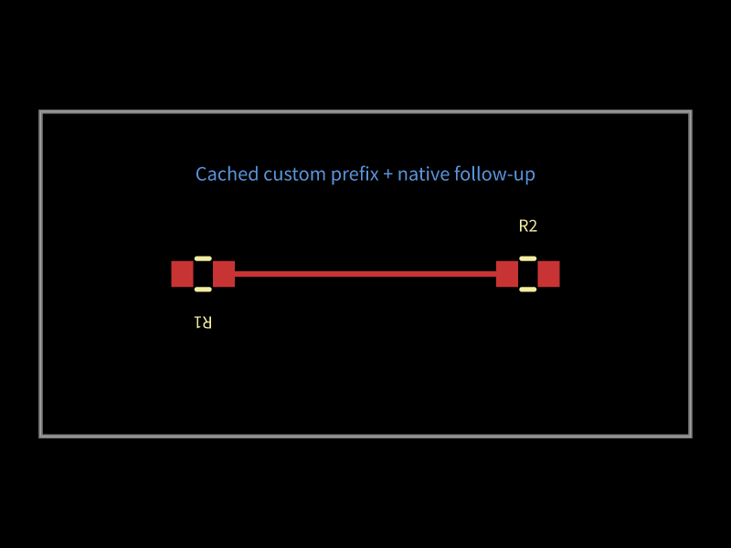

# Multiple native stages must retain their diagnostics

Two stages of the same phase currently write the same input, output and routed
image filenames. The second stage overwrites the evidence needed to understand
the first. This reproduction uses generated native Core events from a cached
synthetic prefix and a native follow-up; it contains no AM3352 capture.

The regression requires separate stage inputs, outputs and images with their
original contents. The stacked fix uses the existing zero-based native stage
index only when the event declares multiple stages. Single-stage filenames
remain compatible. The benchmark measures retained files, exact input hashes,
final-image hashes and timing on identical generated events.

Local comparison (Bun 1.4.0, one warm-up and five measured trials, declared SVG
and snapshot dependencies): two-stage inputs/outputs retained improve from 1/1
to 2/2, images from 1 to 2. Both stages retain their exact original content;
final image SHA-256 is identical on base/head. Single-stage filenames and output
hashes are unchanged. Medians in milliseconds: single 0.068 → 0.095; two without
images 0.120 → 0.156; two with images 284.654 → 281.576. These are diagnostic
artifact costs on a synthetic control, not a board-routing speed claim.

Raw local reports: [base](autorouter-stage-artifacts-local-base.json) and
[head](autorouter-stage-artifacts-local-head.json). Blacksmith CI repeats the
paired comparison on every PR and checks content retention and compatibility.

Hosted Blacksmith run [40227035922](https://github.com/tscircuit/cli/actions/runs/40227035922)
is green (Bun 1.4.2, 8 ARM CPUs): retention and hash compatibility checks pass,
and 12/12 focused tests pass with 77 assertions. Median milliseconds base/head:
single 0.293/0.220, two without images 0.360/0.397, two with images 94.826/88.838.
This is a small synthetic diagnostic workload; no board routing speed inference.
Raw hosted reports: [base](autorouter-stage-artifacts-blacksmith-base.json),
[head](autorouter-stage-artifacts-blacksmith-head.json).
