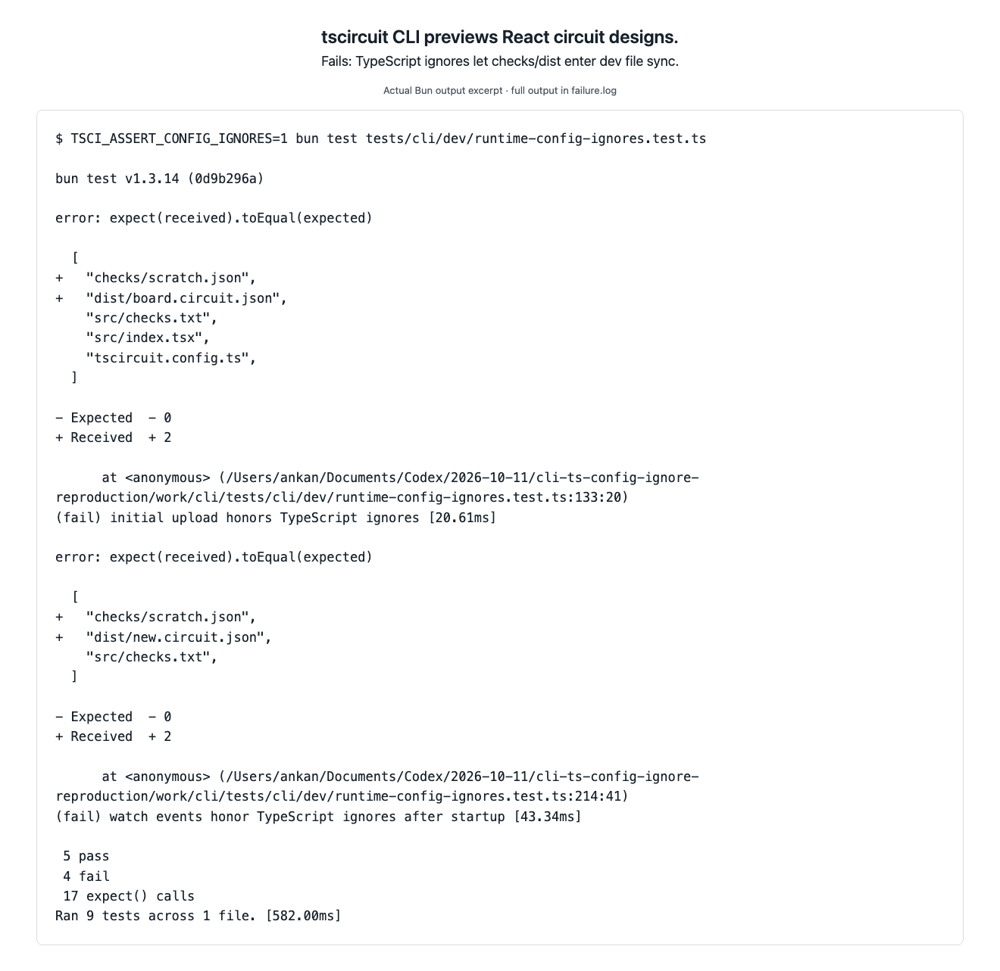
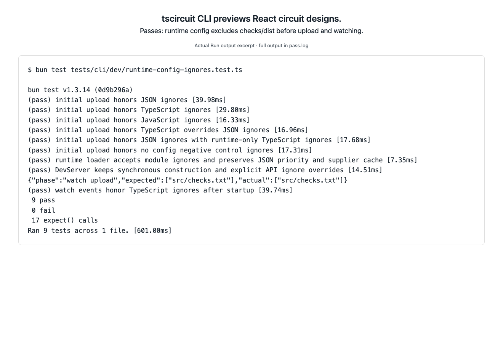

# Dev file sync ignores module configuration

The tscircuit CLI previews React circuit designs with a local development server.
At upstream `a81ea2d13b3ee108f5a3a055126e37186768c44b` (0.1.2296), a valid
`tscircuit.config.ts` or `.js` containing `ignoredFiles: ["checks", "dist"]`
does not exclude those directories from initial upload or filesystem changes.
The synchronous DevServer constructor reads JSON only; the supported async
runtime loader already accepts module ignores and merges JSON then module config.

This discrepancy was found while auditing
[usb-c-peltier-board](https://github.com/0hmX/usb-c-peltier-board) with CLI 0.1.2287.
That project's generated output coincided with startup HTTP timeouts, but this
reproduction makes no claim that excluding files fixes every timeout. It verifies
the configuration mismatch independently with tiny files, real HTTP file-server
requests, and a real Chokidar watcher. The audit checkout was not modified.

On [reproduction PR #5280](https://github.com/tscircuit/cli/pull/5280), branch
`repro/dev-runtime-config-ignores`, run the expected-failure reproduction:

```sh
bun install --frozen-lockfile
bun test tests/cli/dev/runtime-config-ignores.test.ts
```

Four regressions use `test.failing` so the reproduction can pass CI. To see their
ordinary assertion failures without changing the implementation or test:

```sh
TSCI_ASSERT_CONFIG_IGNORES=1 bun test tests/cli/dev/runtime-config-ignores.test.ts
```

The captured run has **5 pass, 4 fail**. TypeScript and JavaScript both upload
`checks/scratch.json` and `dist/board.circuit.json`. In the conflicting JSON+TS
case, JSON's `src` ignore wins incorrectly. After startup, generated changes and
additions also reach `/api/files/upsert`; an unignored source edit is the positive
watcher control. Public handlers are additionally awaited to verify exclusions
without timing an event that should never occur.

Passing controls verify JSON-only ignores, JSON ignores alongside runtime-only
TypeScript, generated output uploading with no configuration, synchronous API
behavior, explicit `server.ignoredFiles` replacement before `start()`, and runtime
loader priority with JSON build settings and a callable supplier cache retained.
The test fixture clears the file-server bundle's shared storage through its API
before each startup, preventing files from earlier tests contaminating results.



[Full, unedited Bun failure output](failure.log). The image renders excerpts from
that actual run on white; it is evidence, not an expected snapshot baseline.
No failure output was blessed as correct behavior.

Related config and ignore tests pass on the reproduction branch with the
expected-failure wrappers: **28 pass, 0 fail**. Type checking, formatting of the
new test, and `git diff --check` also pass.

The stacked fix loads `loadRuntimeProjectConfig` at the beginning of `start()`,
before opening the server, starting watchers, or uploading files. The constructor
and `loadProjectConfig`/`loadProjectConfigSync` remain synchronous. Explicit
`server.ignoredFiles` replacement before startup takes precedence; otherwise the
existing runtime loader handles JSON fallback and module priority. No loader,
schema, default exclusion, request timeout, or dependency-upload behavior changed.

On the fix branch the same assertions are ordinary tests; the expected-failure
wrappers and environment switch are removed:

```sh
bun test tests/cli/dev/runtime-config-ignores.test.ts
```

Actual result: **9 pass, 0 fail**. Generated files are excluded at startup and
after subsequent changes, while the source edit still syncs. Broader dev-server,
project-config, and ignore tests: **51 pass, 1 existing skip, 0 fail** across
19 files. Full type checking and focused Biome checks pass.



[Full, unedited passing output](pass.log). The original failure log and image
are preserved unchanged. Merge the reproduction first, then retarget the stacked
fix to `main` and merge it second after review. Neither PR is merged by this task.
